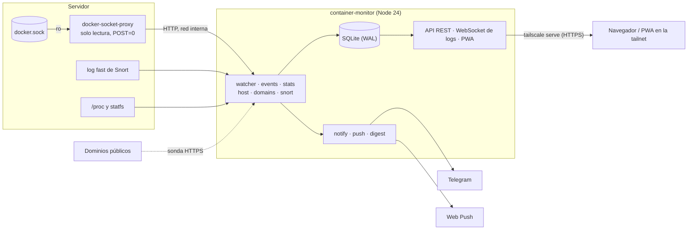
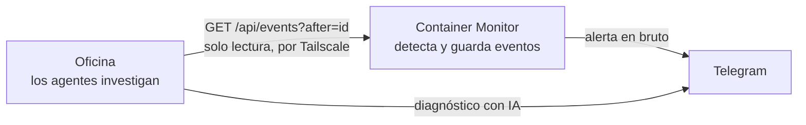

# Container Monitor

[English](README.md) · **Español**

Panel de salud, histórico y alertas de los contenedores Docker de un VPS pequeño. Un solo
contenedor de Node.js hace lo que normalmente se reparte entre Prometheus, Grafana y Alertmanager.
Avisa por Telegram y con notificaciones push al móvil, y el panel se instala como app (PWA).


<sub>Captura con datos de demostración.</sub>

## Qué hace

| | |
|---|---|
| **Avisa** | Detecta cambios de estado: un contenedor que se para (`running` a `exited`), un healthcheck en rojo, reinicios, bucles de reinicio, OOM, un contenedor cerca de su propio límite de memoria, y disco, RAM, swap, CPU y carga del host. Los manda por Telegram y por Web Push. |
| **Avisa rápido** | Escucha el stream de eventos de Docker: una caída se ve en un segundo, no en el siguiente sondeo de 20 s. |
| **Avisa una vez** | Los umbrales y los dominios avisan al pasar la raya y otra vez al recuperarse (con histéresis). Los avisos repetidos se descartan. Una ráfaga de cambios, como reiniciar un stack, llega como un único resumen. |
| **Recuerda** | Guarda en SQLite las métricas de cada contenedor y del host durante 14 días, y los eventos durante 28. También guarda las alertas de Snort. |
| **Muestra** | Una portada con lo que está mal arriba, gráficas del host, la ficha de cada contenedor (CPU, memoria, red), eventos filtrables, dominios con su latencia de 24 h, una pestaña de seguridad y logs en vivo. |
| **Vigila dominios** | Revisa por HTTPS cada dominio que enruta Traefik, descubierto solo a partir de las labels de los contenedores. Un fallo se confirma con una segunda sonda. También lleva la cuenta de los días que le quedan a cada certificado. |
| **Se vigila** | `/api/health` devuelve 503 si el bucle principal se para. Un watchdog interno sale del proceso si pasan 5 minutos sin pasada, para que Docker lo relance. El resumen diario por Telegram sirve de latido. |
| **Se configura desde el panel** | Pestaña Ajustes con validación. Los cambios se aplican en caliente o tras reiniciar, y cada uno queda registrado como evento. |

### Lo que deliberadamente no hace

No monta Prometheus, Grafana, Alertmanager, cAdvisor ni exporters aparte. Serían ocho servicios
en una máquina de 2 vCPU y 8 GB. Un solo contenedor cubre el objetivo real, enterarse de lo que
pasa, sin ese coste.

## Arquitectura



| Módulo | Para qué |
|---|---|
| `server/watcher.js` | Sondea Docker, compara con el estado anterior y convierte los cambios en eventos (el bus de alertas) |
| `server/events.js` | Stream `/events` de Docker; adelanta el sondeo cuando pasa algo |
| `server/stats.js` | Muestreo cada 30 s a SQLite; memoria de cada contenedor contra su límite |
| `server/host.js` | Métricas del host desde `/proc` y `statfs` |
| `server/domains.js` | Sonda HTTPS y días de certificado, con avisos por estado |
| `server/snort.js` | Sigue el log de Snort, aplica la allowlist y guarda las alertas |
| `server/notify.js` · `push.js` · `digest.js` | Telegram, Web Push (VAPID) y el resumen diario |
| `server/settings.js` | Catálogo único de ajustes (`.env` + `data/settings.json`) |
| `server/db.js` | SQLite en modo WAL, retención |
| `server/index.js` | API, WebSocket de logs, estáticos de la PWA y watchdog |
| `public/` | La PWA: JavaScript sin framework y sin paso de build |

## Se conecta con la Oficina

[**Oficina**](https://github.com/Ghambitho14/oficina) es otro proyecto: una oficina virtual en 3D donde agentes de IA
investigan lo que este monitor detecta. **El monitor detecta y la Oficina investiga.**



El monitor no sabe que la Oficina existe: ella lee la API cada pocos segundos usando el `id` del evento como cursor,
así que si estuvo apagada no se pierde ni se repite nada. Si una se cae, la otra sigue, y el monitor no necesita
configuración. En la Oficina basta con poner `MONITOR_URL` con la dirección de este panel. Lee `/api/events`,
`/api/overview`, `/api/snort/summary` y `/api/containers/:id/logs` (desde la 2.4.0).

## Diseño de seguridad

- **La app nunca toca el socket de Docker.** Habla HTTP con
  [`tecnativa/docker-socket-proxy`](https://github.com/Tecnativa/docker-socket-proxy), que solo
  permite lecturas (contenedores, info, eventos) y tiene `POST=0`. Aunque alguien alcanzara el
  proceso, no podría crear contenedores ni escalar a root en el host.
- **No se publica en internet.** El puerto escucha solo en la IP de Tailscale del servidor y en
  loopback, y no hay labels de Traefik. El HTTPS lo pone `tailscale serve` con el certificado del
  nodo. Las notificaciones push sí llegan al móvil fuera de la tailnet, porque el servidor las
  entrega al servicio de push de Google, Apple o Mozilla, no al teléfono.
- **Las escrituras exigen un `Origin` correcto.** Los `PUT`/`POST` piden JSON y una cabecera
  `Origin` igual al host. Un `curl` sin `Origin` recibe **403**. Esto frena el CSRF y los scripts
  descuidados.
- **El modelo de confianza se cuenta tal cual: no hay autenticación.** La única barrera es la red.
  Quien llega al panel puede leerlo todo, incluidos los logs de cualquier contenedor, y cambiar los
  ajustes. Si otras personas entran en la tailnet, lo que protege de verdad es una ACL de Tailscale
  limitada a tus dispositivos.
- El token de Telegram nunca se devuelve al navegador. `data/settings.json` se escribe con modo 600.
- El filtro de Snort descarta el tráfico de la tailnet y de las redes privadas, para que el SSH
  normal por Tailscale no inunde el canal de avisos.

## Tecnologías

- **Backend:** Node.js 24, Express 5, `node:sqlite` integrado (WAL), dockerode, ws, web-push
- **Frontend:** PWA en JavaScript sin framework, con service worker y Web Push (VAPID)
- **Infraestructura:** Docker Compose, docker-socket-proxy, Tailscale (`tailscale serve`),
  Telegram Bot API, Snort
- **Pruebas:** `node:test`, sin dependencias extra

## Puesta en marcha

Hace falta un servidor Linux con Docker y Compose, y Tailscale. Telegram, Traefik y Snort son
opcionales.

```bash
git clone https://github.com/Ghambitho14/container-monitor.git container-monitor
cd container-monitor
cp .env.example .env       # rellenar MONITOR_BIND_IP (IP de Tailscale del servidor) y Telegram
docker compose up -d --build
tailscale serve --bg --https=8443 http://127.0.0.1:3000   # una vez; persiste
```

Se abre en `https://<servidor>.<tailnet>.ts.net:8443` desde cualquier dispositivo de la tailnet.

- **Sin credenciales de Telegram la app arranca igual.** Los eventos se guardan y se ven en la
  pestaña *Eventos*, pero no se envía nada. `setup-telegram.sh` valida el token, busca el chat ID,
  manda un mensaje de prueba y escribe el `.env`.
- **Los dominios** se descubren de las labels `Host(...)` de Traefik, que es como Coolify publica
  las apps. Otros dominios, o una ruta de salud propia, se añaden con `DOMAIN_EXTRA`.
- **Snort** se lee de `/var/log/snort/snort.alert.fast`. Si no lo usas, pon `SNORT_ENABLED=false`.

### En el móvil

1. Con Tailscale activo, abrir la dirección del panel.
2. **Android (Chrome):** botón *Instalar* del carril, o menú y luego *Añadir a pantalla de inicio*.
   **iPhone (Safari):** compartir y luego *Añadir a pantalla de inicio*. En iOS 16.4+ es
   obligatorio para recibir push.
3. Abrir la app instalada, pulsar **Alertas** y aceptar las notificaciones. Llega una de prueba.

Desde ese momento los avisos `warn` y `crit` llegan al móvil aunque la app esté cerrada. La
severidad mínima se elige con `PUSH_MIN_SEVERITY`.

## Configuración

Los ajustes se cambian desde la pestaña **Ajustes** o en el `.env`. En
[`.env.example`](.env.example) están todas las variables.

El orden de precedencia es: valor de serie, luego `.env`, luego `data/settings.json`, que es lo
que guarda el panel. El panel nunca modifica el `.env`.

| Variable | De serie | Para qué |
|---|---|---|
| `MONITOR_BIND_IP` | — | IP de Tailscale en la que escucha el panel (la exige `docker-compose.yml`) |
| `ALERT_DEDUPE_MINUTES` | 15 | No repetir el mismo aviso del mismo objeto |
| `ALERT_GROUP_THRESHOLD` | 4 | Más de N cambios a la vez se envían como un único resumen |
| `ALERT_CPU_PCT` / `ALERT_SUSTAIN_MINUTES` | 90 / 5 | CPU y carga se evalúan como media sostenida |
| `ALERT_HYSTERESIS_PCT` | 5 | Margen para dar un umbral por recuperado |
| `ALERT_CONTAINER_MEM_PCT` | 90 | Memoria de un contenedor contra su propio límite |
| `ALERT_RESTART_LOOP_COUNT` / `_MINUTES` | 3 / 10 | Qué cuenta como bucle de reinicio |
| `DOMAIN_EXTRA` | — | Dominios o rutas extra (`host` o `host/ruta`, separados por comas) |
| `SNORT_IGNORE_CIDRS` | `100.64.0.0/10`, … | Orígenes cuyas alertas de Snort se ignoran |
| `DIGEST_HOUR` | 8 | Hora (reloj del contenedor) del resumen diario silencioso |
| `PUSH_MIN_SEVERITY` | warn | Severidad mínima que llega por push |
| `RETENTION_DAYS` | 14 | Antigüedad máxima de las muestras (los eventos duran el doble) |

## Eventos

| Tipo | Severidad | Cuándo |
|---|---|---|
| `container_down` / `container_up` | crit / info | Pasa a exited/dead y vuelve |
| `container_unhealthy` / `container_healthy` | crit / info | Healthcheck |
| `container_restarted` | warn | Sube `RestartCount` (con código de salida y OOM si aplica) |
| `container_restart_loop` | crit | N reinicios en M minutos |
| `container_oom` | crit | Evento `oom` de Docker |
| `container_mem` / `container_mem_ok` | warn / info | Memoria contra el límite del contenedor |
| `container_new` / `container_gone` / `container_paused` | info / warn / warn | Ciclo de vida |
| `host_disk`, `host_mem`, `host_swap`, `host_cpu`, `host_load` (+ `_ok`) | crit/warn / info | Umbrales del host, por estado |
| `domain_down` / `domain_up` | crit / info | Sonda HTTPS (con el tiempo caído al volver) |
| `cert_expiring` | warn/crit | Como mucho una vez al día por dominio |
| `snort` | warn/crit | N alertas del mismo origen dentro de la ventana |
| `monitor_docker_unreachable` / `monitor_docker_ok` | crit / info | El propio monitor no llega a Docker |
| `config_changed` | info (no se envía) | Ajustes guardados desde el panel |

## API

| Endpoint | Devuelve |
|---|---|
| `GET /api/health` | Estado de cada componente; **503** si el watcher está parado |
| `GET /api/overview` | Todo lo de la portada: contenedores, host, alertas activas, dominios, estado del monitor y `monitor.config` (umbrales e intervalos en uso) |
| `GET /api/containers` · `/api/containers/:id` | Listado y ficha (inspect, healthchecks fallidos) |
| `GET /api/containers/:id/logs?since=<unix s>&tail=200` | Logs ya escritos, en líneas de texto (`tail` hasta 2000). La versión sin WebSocket del visor, para que otra app (p. ej. la Oficina) cuente errores |
| `GET /api/history/:id?hours=6` | Muestras (agregadas en rangos largos) y eventos |
| `GET /api/host?hours=6` | Serie del host, picos y umbrales |
| `GET /api/events?limit=100&hours=24&severity=crit&notified=1` | Últimos eventos; los filtros se aplican antes del límite |
| `GET /api/events?after=<id>&limit=100` | Eventos posteriores a ese `id`, del más viejo al más nuevo. Sirve de cursor para que otra app (p. ej. la Oficina) los lea sin perder ni repetir |
| `GET /api/domains` · `/api/domains/:domain/history?hours=24` | Última sonda y serie de latencia |
| `GET /api/snort?limit=50` · `/api/snort/summary?hours=24` | Alertas y totales por origen y regla |
| `GET /api/digest` | Vista previa del resumen diario |
| `GET /api/push/public-key` · `POST /api/push/subscribe` · `/unsubscribe` · `/test` | Web Push |
| `GET /api/settings` · `PUT /api/settings` `{changes:{clave: valor\|null}}` | Ajustes (`null` quita el valor del panel) |
| `POST /api/settings/restart` · `/telegram-test` | Reiniciar el monitor · mensaje de prueba |
| `WS /api/logs/:id?tail=200` | Logs en vivo |

## Desarrollo

```bash
npm ci
npm test                    # node --test, sin dependencias extra
npm run check               # sintaxis, y .env.example y README al día con el código
node scripts/dev-proxy.mjs  # panel local en http://127.0.0.1:3100 contra un monitor en marcha
```

`dev-proxy` sirve `public/` desde el disco y reenvía `/api/*` al servidor de `MONITOR_URL`.
`npm run deploy` sube el código al servidor de `MONITOR_SSH`, con copia previa y vuelta atrás
automática. Los dos leen estas variables del entorno o de `.env.deploy`, que git ignora.

El despliegue, las copias de seguridad, la restauración y la operación diaria están en
[docs/operacion.md](docs/operacion.md). Historial de cambios: [CHANGELOG.md](CHANGELOG.md).

## Estructura

```
server/    backend (un módulo por responsabilidad)
public/    PWA: index.html, app.js, styles.css, service worker
scripts/   check, deploy, dev-proxy, backup
test/      pruebas unitarias y prueba de humo del servidor completo
docs/      guía de operación
```
