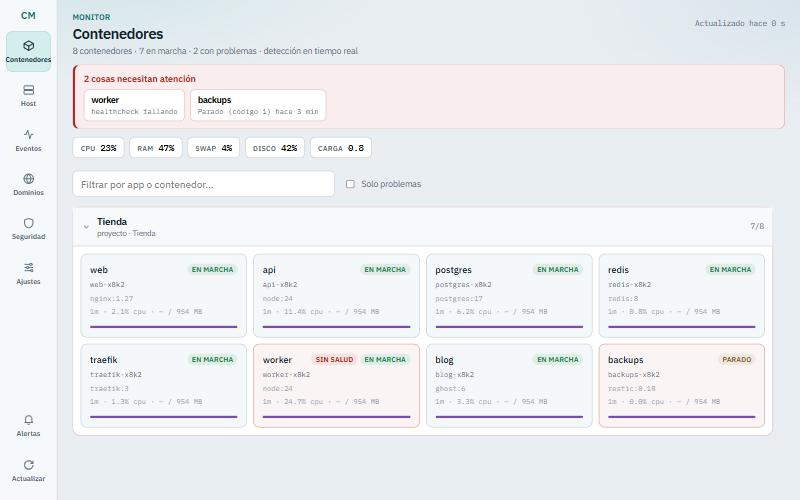
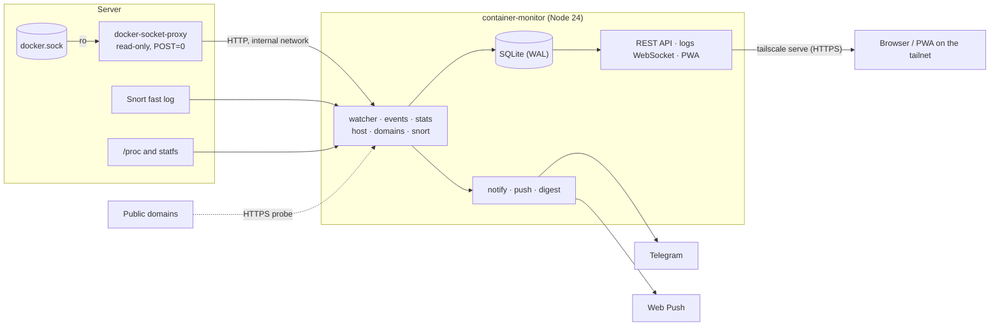
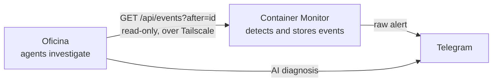

# Container Monitor

**English** · [Español](README.es.md)

A health, history and alerting panel for the Docker containers on a small VPS. One Node.js
container does the job usually split across Prometheus, Grafana and Alertmanager. It sends
alerts to Telegram and as push notifications to your phone, and the panel installs as an app (PWA).


> The panel, the alert messages and the code comments are written in Spanish.



<sub>Screenshot with demo data.</sub>

## What it does

| | |
|---|---|
| **Alerts** | Detects state changes: a container that stops (`running` to `exited`), a failing healthcheck, restarts, restart loops, OOM kills, a container near its own memory limit, and host disk, RAM, swap, CPU and load. Sends them to Telegram and as Web Push. |
| **Reacts fast** | Listens to Docker's event stream, so a crash shows up in about a second, not at the next 20 s poll. |
| **Stays quiet** | Thresholds and domains alert once when they cross the line and once when they recover (with hysteresis). Repeated alerts are suppressed. A burst of changes, such as a stack restart, arrives as one summary. |
| **Remembers** | Stores per-container and host metrics in SQLite for 14 days, and events for 28. Snort alerts are kept too. |
| **Shows** | An overview with problems at the top, host charts, a detail view per container (CPU, memory, network), filterable events, domains with 24 h latency, a security tab and live logs. |
| **Watches domains** | Probes over HTTPS every domain routed by Traefik, found automatically from container labels. A failure is confirmed by a second probe. Also tracks how many days each certificate has left. |
| **Watches itself** | `/api/health` returns 503 if the main loop stalls. An internal watchdog exits the process after 5 minutes without a pass, so Docker restarts it. The daily Telegram digest doubles as a heartbeat. |
| **Configurable from the panel** | A Settings tab with validation. Changes apply live or after a restart, and each one is logged as an event. |

### What it deliberately does not do

It does not run Prometheus, Grafana, Alertmanager, cAdvisor or separate exporters. That would be
eight services on a 2 vCPU / 8 GB machine. A single container covers the real goal, knowing what
is happening, without that cost.

## Architecture



| Module | Role |
|---|---|
| `server/watcher.js` | Polls Docker, compares with the previous state and turns changes into events (the alert bus) |
| `server/events.js` | Docker `/events` stream; triggers an early poll when something happens |
| `server/stats.js` | Samples every 30 s into SQLite; container memory against its limit |
| `server/host.js` | Host metrics from `/proc` and `statfs` |
| `server/domains.js` | HTTPS probe and certificate days, state-based alerts |
| `server/snort.js` | Follows the Snort log, applies the allowlist, stores alerts |
| `server/notify.js` · `push.js` · `digest.js` | Telegram, Web Push (VAPID) and the daily digest |
| `server/settings.js` | Single catalog of settings (`.env` + `data/settings.json`) |
| `server/db.js` | SQLite in WAL mode, retention |
| `server/index.js` | API, logs WebSocket, PWA static files, watchdog |
| `public/` | The PWA: plain JavaScript, no framework and no build step |

## Works with the Oficina

[**Oficina**](https://github.com/Ghambitho14/oficina) is a separate project: a 3D virtual office where AI agents
investigate what this monitor detects. **The monitor detects, the Oficina investigates.**



The monitor does not know the Oficina exists: the Oficina reads the API every few seconds using the event `id` as a
cursor, so nothing is lost or repeated if it was offline. Either one keeps working if the other goes down, and the
monitor needs no configuration. On the Oficina side, set `MONITOR_URL` to this panel's address. It reads
`/api/events`, `/api/overview`, `/api/snort/summary` and `/api/containers/:id/logs` (2.4.0 or later).

## Security design

- **The app never touches the Docker socket.** It talks HTTP to
  [`tecnativa/docker-socket-proxy`](https://github.com/Tecnativa/docker-socket-proxy), which only
  allows reads (containers, info, events) and has `POST=0`. Even if someone reached the process, it
  could not create containers or escalate to root on the host.
- **It is not published on the internet.** The port is bound only to the server's Tailscale IP
  and to loopback, and there are no Traefik labels. HTTPS comes from `tailscale serve` with the
  node's certificate. Push notifications still reach the phone outside the tailnet, because the
  server hands them to Google, Apple or Mozilla push services, not to the phone directly.
- **Writes need a matching `Origin`.** `PUT`/`POST` endpoints require JSON and an `Origin`
  header equal to the host. A `curl` without `Origin` gets **403**. This stops CSRF and careless
  scripts.
- **The trust model is stated plainly: there is no authentication.** The network is the only
  barrier. Anyone who reaches the panel can read everything, including container logs, and change
  settings. If other people join the tailnet, a Tailscale ACL limited to your devices is what
  actually protects it.
- The Telegram token is never sent back to the browser. `data/settings.json` is written with mode 600.
- The Snort filter drops traffic from the tailnet and private ranges, so routine SSH over
  Tailscale does not flood the alert channel.

## Tech stack

- **Backend:** Node.js 24, Express 5, built-in `node:sqlite` (WAL), dockerode, ws, web-push
- **Frontend:** a PWA in plain JavaScript, with a service worker and Web Push (VAPID)
- **Infrastructure:** Docker Compose, docker-socket-proxy, Tailscale (`tailscale serve`),
  Telegram Bot API, Snort
- **Tests:** `node:test`, with no extra dependencies

## Getting started

Requirements: a Linux server with Docker and Compose, and Tailscale. Telegram, Traefik and Snort
are optional.

```bash
git clone https://github.com/Ghambitho14/container-monitor.git container-monitor
cd container-monitor
cp .env.example .env       # set MONITOR_BIND_IP (the server's Tailscale IP) and the Telegram values
docker compose up -d --build
tailscale serve --bg --https=8443 http://127.0.0.1:3000   # once; it persists
```

Open `https://<server>.<tailnet>.ts.net:8443` from any device on the tailnet.

- **Without Telegram credentials the app still runs.** Events are stored and visible in the
  *Eventos* tab, but nothing is sent. `setup-telegram.sh` checks the token, finds the chat ID,
  sends a test message and writes `.env`.
- **Domains** are discovered from Traefik `Host(...)` labels, which is how Coolify publishes apps.
  Add others, or a custom health path, with `DOMAIN_EXTRA`.
- **Snort** is read from `/var/log/snort/snort.alert.fast`. Set `SNORT_ENABLED=false` if you do
  not use it.

### On your phone

1. With Tailscale on, open the panel URL.
2. **Android (Chrome):** the *Instalar* button in the side bar, or menu, then *Add to Home screen*.
   **iPhone (Safari):** Share, then *Add to Home Screen*. This is required for push on iOS 16.4+.
3. Open the installed app and tap **Alertas**, then allow notifications. A test notification arrives.

From then on, `warn` and `crit` alerts reach the phone even with the app closed. The threshold
is set by `PUSH_MIN_SEVERITY`.

## Configuration

Settings are edited from the **Ajustes** tab or in `.env`. See [`.env.example`](.env.example)
for every variable.

Precedence is: built-in default, then `.env`, then `data/settings.json`, which is what the panel
saves. The panel never modifies `.env`.

| Variable | Default | Purpose |
|---|---|---|
| `MONITOR_BIND_IP` | — | Tailscale IP the panel listens on (required by `docker-compose.yml`) |
| `ALERT_DEDUPE_MINUTES` | 15 | Do not repeat the same alert for the same object |
| `ALERT_GROUP_THRESHOLD` | 4 | More than N changes at once become a single summary |
| `ALERT_CPU_PCT` / `ALERT_SUSTAIN_MINUTES` | 90 / 5 | CPU and load are judged as a sustained average |
| `ALERT_HYSTERESIS_PCT` | 5 | Margin before a threshold counts as recovered |
| `ALERT_CONTAINER_MEM_PCT` | 90 | A container's memory against its own limit |
| `ALERT_RESTART_LOOP_COUNT` / `_MINUTES` | 3 / 10 | What counts as a restart loop |
| `DOMAIN_EXTRA` | — | Extra domains or paths (`host` or `host/path`, comma-separated) |
| `SNORT_IGNORE_CIDRS` | `100.64.0.0/10`, … | Sources Snort alerts are ignored for |
| `DIGEST_HOUR` | 8 | Hour (container clock) of the silent daily digest |
| `PUSH_MIN_SEVERITY` | warn | Lowest severity sent as push |
| `RETENTION_DAYS` | 14 | Maximum age of samples (events last twice as long) |

## Events

| Kind | Severity | When |
|---|---|---|
| `container_down` / `container_up` | crit / info | Goes to exited/dead and comes back |
| `container_unhealthy` / `container_healthy` | crit / info | Healthcheck |
| `container_restarted` | warn | `RestartCount` goes up (with exit code and OOM if any) |
| `container_restart_loop` | crit | N restarts within M minutes |
| `container_oom` | crit | Docker `oom` event |
| `container_mem` / `container_mem_ok` | warn / info | Memory against the container's limit |
| `container_new` / `container_gone` / `container_paused` | info / warn / warn | Lifecycle |
| `host_disk`, `host_mem`, `host_swap`, `host_cpu`, `host_load` (+ `_ok`) | crit/warn / info | Host thresholds, state-based |
| `domain_down` / `domain_up` | crit / info | HTTPS probe (downtime reported on recovery) |
| `cert_expiring` | warn/crit | At most once a day per domain |
| `snort` | warn/crit | N alerts from the same source within the window |
| `monitor_docker_unreachable` / `monitor_docker_ok` | crit / info | The monitor itself cannot reach Docker |
| `config_changed` | info (not sent) | Settings saved from the panel |

## API

| Endpoint | Returns |
|---|---|
| `GET /api/health` | Status of each component; **503** if the watcher has stalled |
| `GET /api/overview` | Everything on the overview: containers, host, active alerts, domains, monitor status and `monitor.config` (thresholds and intervals in use) |
| `GET /api/containers` · `/api/containers/:id` | List and detail (inspect, failed healthchecks) |
| `GET /api/containers/:id/logs?since=<unix s>&tail=200` | Logs already written, as text lines (max `tail` 2000). The non-WebSocket version of the viewer, for another app (e.g. the Oficina) to count errors |
| `GET /api/history/:id?hours=6` | Samples (bucketed over long ranges) and events |
| `GET /api/host?hours=6` | Host series, peaks and thresholds |
| `GET /api/events?limit=100&hours=24&severity=crit&notified=1` | Latest events; filters apply before the limit |
| `GET /api/events?after=<id>&limit=100` | Events after that `id`, oldest first. A cursor so another app (e.g. the Oficina) can read them without gaps or repeats |
| `GET /api/domains` · `/api/domains/:domain/history?hours=24` | Latest probe and latency series |
| `GET /api/snort?limit=50` · `/api/snort/summary?hours=24` | Alerts and totals by source and rule |
| `GET /api/digest` | Preview of the daily digest |
| `GET /api/push/public-key` · `POST /api/push/subscribe` · `/unsubscribe` · `/test` | Web Push |
| `GET /api/settings` · `PUT /api/settings` `{changes:{key: value\|null}}` | Settings (`null` removes the panel value) |
| `POST /api/settings/restart` · `/telegram-test` | Restart the monitor · send a test message |
| `WS /api/logs/:id?tail=200` | Live logs |

## Development

```bash
npm ci
npm test                    # node --test, no extra dependencies
npm run check               # syntax, .env.example and README kept in sync with the code
node scripts/dev-proxy.mjs  # local panel at http://127.0.0.1:3100 against a running monitor
```

`dev-proxy` serves `public/` from disk and forwards `/api/*` to the server set in `MONITOR_URL`.
`npm run deploy` uploads to the server set in `MONITOR_SSH`, with a backup beforehand and an
automatic rollback. Both read these variables from the environment or from `.env.deploy`, which
git ignores.

Deployment, backups, restores and day-to-day operation are covered in
[docs/operacion.md](docs/operacion.md) (Spanish). Change history: [CHANGELOG.md](CHANGELOG.md).

## Project layout

```
server/    backend (one module per concern)
public/    PWA: index.html, app.js, styles.css, service worker
scripts/   check, deploy, dev-proxy, backup
test/      unit tests and a smoke test of the whole server
docs/      operations guide
```
